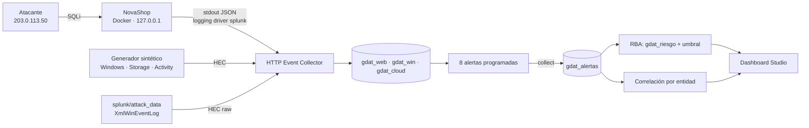
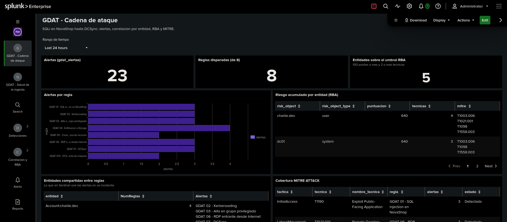
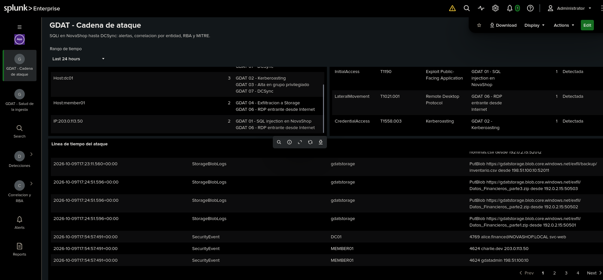
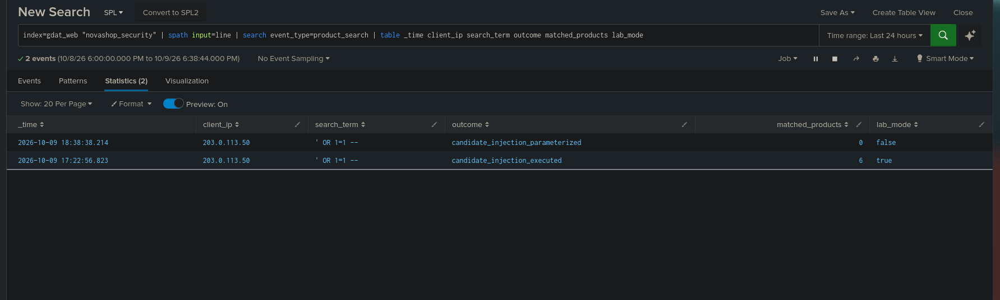
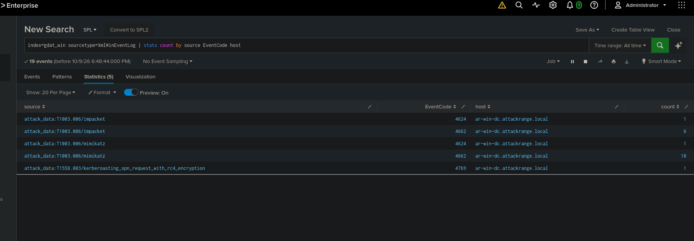
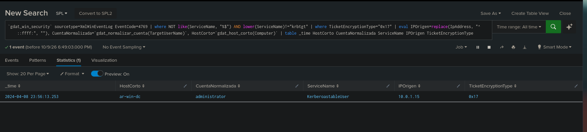
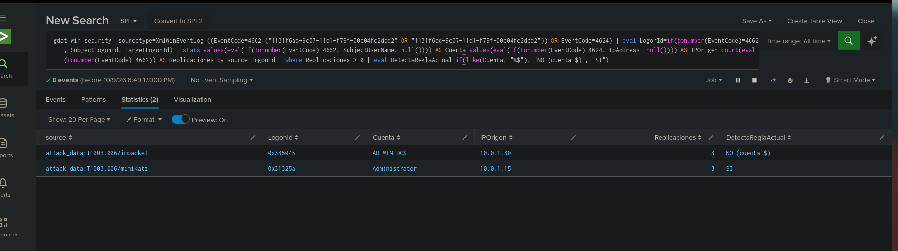
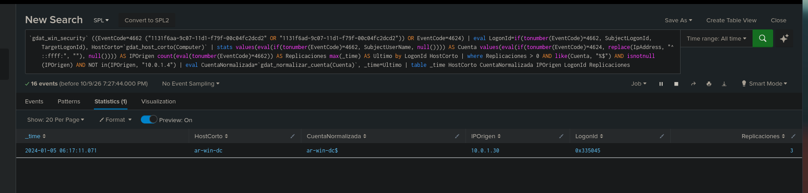
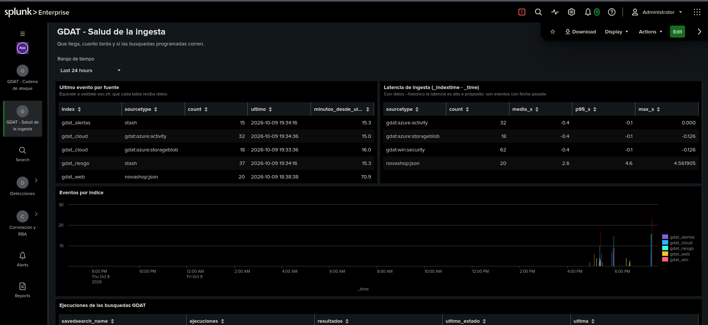
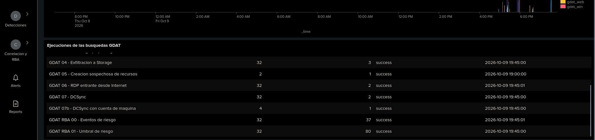

# GDAT · Laboratorio SOC en Splunk

> Laboratorio personal de detection engineering en Splunk Enterprise: una cadena de ataque completa
> (SQLi → RDP → Kerberoasting → escalada → exfiltración → DCSync) detectada con 8 reglas en SPL mapeadas a
> MITRE ATT&CK, correlacionada por entidad y puntuada con Risk-Based Alerting. Todo corre en local.


## Qué es

GDAT es mi laboratorio SOC de uso propio, montado en mi equipo para practicar ingeniería de detecciones,
correlación y operación de Splunk. Los comandos de este documento reflejan lo que se ejecutó al construirlo (2026-10-09).

- Las detecciones se versionan como código: una app de Splunk (`gdat_soc`) generada a partir de ficheros `.spl`.
- La correlación funciona sin Splunk ES: alertas agrupadas por entidad (cuenta, IP, host), como el incidente de Sentinel.
- **RBA ligero:** cada alerta suma riesgo a sus entidades y salta un "incidente" cuando una entidad
  acumula 100 puntos o más con dos o más técnicas MITRE.
- Cada regla se prueba con un caso que debe saltar **y** con ruido que no debe saltar.

## Entorno

| Componente | Detalle |
|---|---|
| Splunk | Contenedor `splunk-gdat` (imagen `splunk/splunk:latest`). Web http://127.0.0.1:8001, HEC 8188, API 8189. Volúmenes `splunk-gdat-etc` y `splunk-gdat-var`. Licencia Trial: 500 MB/día, caduca el 2026-12-08 (después pasa a Free, que no tiene alertas programadas) |
| App | `gdat_soc` en `/opt/splunk/etc/apps/gdat_soc`. Índices `gdat_web`, `gdat_win`, `gdat_cloud`, `gdat_alertas` y `gdat_riesgo` |
| Dashboards | http://127.0.0.1:8001/en-US/app/gdat_soc/gdat_cadena y http://127.0.0.1:8001/en-US/app/gdat_soc/gdat_salud |
| HEC | Token `gdat-hec` (acceso solo a `gdat_*`). Guardado en `.env.local` y en `splunk_app/gdat_soc/local/inputs.conf`, ambos con permisos 600 |
| NovaShop | Contenedor `gdat-novashop` (imagen `gdat-novashop`), publicado solo en http://127.0.0.1:5001. El código de la aplicación no se incluye: su ruta se indica en `.novashop.local` o en `NOVASHOP_SRC` |

## Qué es real y qué es simulado

| Fuente | Origen | Referencia en Sentinel |
|---|---|---|
| NovaShop (web vulnerable) | **Real**: la aplicación corre en Docker y el ataque SQLi se lanza de verdad | `AppServiceConsoleLogs` |
| Eventos de seguridad de Windows (4624, 4662, 4688, 4728, 4769) | **Simulados** con `generador/gdat_generar.py` | `SecurityEvent` |
| Logs de Storage (PutBlob) | **Simulados** | `StorageBlobLogs` |
| Azure Activity | **Simulados** | `AzureActivity` |
| Kerberoasting y DCSync de [splunk/attack_data](https://github.com/splunk/attack_data) | **Reales** (`XmlWinEventLog`, 2024), cargados sin modificar | `SecurityEvent` |

Los eventos simulados usan los **nombres de campo nativos de Windows** (`EventCode`, `TargetUserName`,
`IpAddress`…), así que el SPL es el mismo que con `XmlWinEventLog` real. Las IPs del laboratorio son rangos
de documentación (RFC 5737) o privadas, y todas las identidades son ficticias: atacante `203.0.113.50`,
administración `198.51.100.10`, MEMBER01 `10.0.1.5` (salida pública `192.0.2.15`), DC01 `10.0.1.4`, dominio `novashop.local`.

## Arquitectura



## Detecciones (SPL ↔ KQL ↔ MITRE ATT&CK)

| # | Detección | Telemetría | MITRE ATT&CK | Frecuencia | SPL |
|---|---|---|---|---|---|
| 1 | SQL injection en NovaShop | Log de seguridad de la app | [T1190](https://attack.mitre.org/techniques/T1190/) | 5 min | [`01-sqli-novashop.spl`](detecciones/01-sqli-novashop.spl) |
| 2 | Kerberoasting | 4769 con RC4 (`0x17`) | [T1558.003](https://attack.mitre.org/techniques/T1558/003/) | 5 min | [`02-kerberoasting.spl`](detecciones/02-kerberoasting.spl) |
| 3 | Alta en grupo privilegiado | 4728 / 4732 (-512, S-1-5-32-544) | [T1098](https://attack.mitre.org/techniques/T1098/) | 1 min (en Sentinel sería NRT) | [`03-grupo-privilegiado.spl`](detecciones/03-grupo-privilegiado.spl) |
| 4 | Exfiltración a Storage | PutBlob con AccountKey | [T1567.002](https://attack.mitre.org/techniques/T1567/002/) | 5 min | [`04-exfiltracion-storage.spl`](detecciones/04-exfiltracion-storage.spl) |
| 5 | Creación sospechosa de recursos | Azure Activity (≥ 5 recursos/h) | [T1578.002](https://attack.mitre.org/techniques/T1578/002/) · T1078.004 | 1 h | [`05-creacion-recursos.spl`](detecciones/05-creacion-recursos.spl) |
| 6 | RDP entrante desde Internet | 4624 tipo 10 desde IP pública | [T1021.001](https://attack.mitre.org/techniques/T1021/001/) | 5 min | [`06-rdp-entrante.spl`](detecciones/06-rdp-entrante.spl) |
| 7 | DCSync | 4662 con derechos de replicación | [T1003.006](https://attack.mitre.org/techniques/T1003/006/) | 5 min | [`07-dcsync-4662.spl`](detecciones/07-dcsync-4662.spl) |
| 7b | DCSync con cuenta de máquina | 4662 cruzado con el 4624 de la sesión (LogonId) | [T1003.006](https://attack.mitre.org/techniques/T1003/006/) | 5 min | [`07b-dcsync-cuenta-maquina.spl`](detecciones/07b-dcsync-cuenta-maquina.spl) |

Cada `.spl` lleva en la cabecera su referencia KQL (campo `kql`), MITRE, severidad, programación y ventana.
`scripts/construir_app.py` los empaqueta en `savedsearches.conf` (no se edita a mano) y añade las búsquedas
`GDAT RBA 00/01` y `GDAT COR`. Cada alerta mira una ventana de 5 minutos desfasada 2 (`-7m@m` → `-2m@m`);
la 03 corre cada minuto (`-2m@m` → `-1m@m`) y la 05, cada hora (`-62m@m` → `-2m@m`).

### Ejemplo: Kerberoasting en KQL y en SPL

```kql
SecurityEvent
| where EventID == 4769
| where ServiceName !endswith "$" and ServiceName !in~ ("krbtgt")
| extend Cifrado = extract(@'Name="TicketEncryptionType"[^>]*>([^<]+)<', 1, tostring(EventData))
| where Cifrado == "0x17"
```

```spl
`gdat_win_security` EventCode=4769
| where NOT like(ServiceName, "%$") AND lower(ServiceName)!="krbtgt"
| where TicketEncryptionType="0x17"
| eval CuentaNormalizada=`gdat_normalizar_cuenta(TargetUserName)`
```

La tabla completa de equivalencias, de conceptos (workspace, DCR, NRT, entity mapping…) y de
operadores (`summarize` → `stats`, `parse_json` → `spath`, `ipv4_is_private` → `cidrmatch`…), está en
[`docs/EQUIVALENCIAS_KQL_SPL.md`](docs/EQUIVALENCIAS_KQL_SPL.md).

## Correlación y RBA

La cadena se cose por entidades compartidas, igual que el entity mapping de Sentinel:

| Entidad | Reglas que la comparten |
|---|---|
| `IP:203.0.113.50` | SQLi, RDP |
| `Account:charlie.dev` | Kerberoasting, grupo privilegiado, RDP, DCSync |
| `Host:member01` | Exfiltración (mapa IP → host), RDP |
| `Host:dc01` | Kerberoasting, grupo privilegiado, DCSync |

**RBA:** las alertas de severidad *high* suman 80 puntos y las *medium*, 40. Hay "incidente" cuando una
entidad suma 100 puntos o más con al menos dos técnicas MITRE en 24 h.

## Resultados

Campañas del 2026-10-09 (detalle en [`pruebas/resultados.md`](pruebas/resultados.md)):

- **8/8 reglas disparadas** (01–07 y 07b). El ruido (RC4 a `krbtgt`, cuentas `$`, RDP desde IP privada o de
  administración, `DC01$` replicando, subidas por OAuth o desde la IP de administración…) **no generó ninguna alerta**.
  En la última campaña, cada regla dio exactamente un resultado.
- **Correlación:** salen exactamente las cuatro uniones esperadas.
- **RBA:** `charlie.dev`, `dc01`, `member01`, `203.0.113.50` y `10.0.1.5` superan el umbral; `charlie.dev` suma 4 técnicas por campaña.
- **Remediación:** la misma SQLi con NovaShop corregida da `candidate_injection_parameterized` y 0 productos (antes, 6).

### Validación con datos reales

Las reglas 02 y 07 se han probado también con eventos **reales** de
[splunk/attack_data](https://github.com/splunk/attack_data), cargados sin modificar (`XmlWinEventLog`):

- ✅ **Kerberoasting real** (T1558.003): la regla 02 lo detecta tal cual.
- ✅ **DCSync con mimikatz** (T1003.006): la regla 07 lo detecta (3 replicaciones de `Administrator`).
- ⚠️ **DCSync con impacket usando la cuenta de máquina del DC** (`AR-WIN-DC$` desde 10.0.1.30): **falso
  negativo**. La regla descarta las cuentas `$` para no alertar de la replicación entre DCs. Cruzando el 4662
  con el 4624 de la misma sesión (`LogonId`) se ve que el origen no es un DC. De ahí la **regla 07b**,
  que ya lo detecta: excluye las cuentas `$` solo cuando la sesión viene de un DC conocido (`gdat_dcs.csv`).

## Capturas

### La cadena detectada
Las 8 reglas disparadas, el riesgo acumulado por entidad (RBA) y la cobertura MITRE:



Entidades compartidas entre reglas (lo que en Sentinel une las alertas en un incidente) y línea de tiempo:



### Remediación
La misma SQLi contra NovaShop vulnerable (6 productos) y corregida (`candidate_injection_parameterized`, 0 productos):



### Validación con datos reales (attack_data)





### Ingeniería de telemetría
Último evento por fuente, latencia de ingesta y ejecuciones de las búsquedas programadas:




## Operación

Salvo que se indique otra cosa, los comandos se ejecutan desde la raíz del repositorio
y las búsquedas SPL, en Splunk (*Search & Reporting* o la app *GDAT SOC*). Cada bloque indica si se ejecutó
durante la construcción del laboratorio (2026-10-09) o si solo está documentado.

### 1. Comprobaciones al empezar una sesión (ejecutadas)

Estado del contenedor y del HEC. Respuestas esperadas: `splunk-gdat: Up … (healthy)` y
`{"text":"HEC is healthy","code":17}`.

```bash
docker ps -a --filter name=splunk-gdat --format '{{.Names}}: {{.Status}}'
curl -sk https://127.0.0.1:8188/services/collector/health
```

Si el contenedor está parado, se arranca con `docker start splunk-gdat`. Antes de enviar datos se comprueba que no haya nada que se pueda duplicar, con el rango en *All time*:

```spl
index=* | stats count by index
```

### 2. Construir e instalar la app `gdat_soc` (ejecutado)

Se usa tras cualquier cambio en `detecciones/`, en los scripts de construcción o en `splunk_app/gdat_soc/`. El
reinicio es necesario para crear índices y para las transformaciones de indexación (`[XmlWinEventLog]`).

```bash
python3 scripts/construir_app.py          # detecciones/*.spl → default/savedsearches.conf
python3 scripts/construir_dashboards.py   # dashboards de Dashboard Studio y menú de la app
docker cp splunk_app/gdat_soc splunk-gdat:/opt/splunk/etc/apps/
docker exec -u root splunk-gdat chown -R splunk:splunk /opt/splunk/etc/apps/gdat_soc
docker restart splunk-gdat
docker inspect -f '{{.State.Health.Status}}' splunk-gdat   # repetir hasta que devuelva healthy (1–2 min)
```

Verificación en Splunk: los índices existen y las macros resuelven bien. A las macros hay que pasarles
**campos**, no literales entre comillas; con literales, la prueba falló.

```spl
| eventcount summarize=false index=gdat_* | table index count
```
```spl
| makeresults | eval u1="NOVASHOP\\Charlie.Dev", u2="charlie.dev@NOVASHOP.LOCAL", ip1="10.0.1.5", ip2="203.0.113.50" | eval a=`gdat_normalizar_cuenta(u1)`, b=`gdat_normalizar_cuenta(u2)`, c=if(`gdat_ip_privada(ip1)`, "privada", "publica"), d=if(`gdat_ip_privada(ip2)`, "privada", "publica") | table u1 a b c d
```

Resultado obtenido: `a=charlie.dev`, `b=charlie.dev`, `c=privada`, `d=publica`.

### 3. Token HEC (ejecutado una vez)

El token se generó en local, sin pasar por la interfaz de Splunk. El primer intento creó `.env.local` y falló
al escribir `inputs.conf` (`permiso denegado`): `umask 177` dejó el directorio `local/` sin permiso de
ejecución. Esta parte del primer comando se ejecutó correctamente:

```bash
cd <raíz-del-repositorio> && \
TOKEN=$(python3 -c "import uuid;print(uuid.uuid4())") && \
umask 177 && \
printf 'GDAT_HEC_TOKEN=%s\nGDAT_HEC_URL=https://127.0.0.1:8188\n' "$TOKEN" > .env.local
```

Este segundo comando completó la configuración reutilizando el token de `.env.local`:

```bash
cd <raíz-del-repositorio> && \
mkdir -p splunk_app/gdat_soc/local && chmod 700 splunk_app/gdat_soc/local && \
TOKEN=$(grep '^GDAT_HEC_TOKEN=' .env.local | cut -d= -f2) && \
( umask 177 && printf '# Token HEC del lab GDAT. NO PUBLICAR.\n[http://gdat-hec]\ndisabled = 0\ntoken = %s\nindex = gdat_cloud\nindexes = gdat_web,gdat_win,gdat_cloud,gdat_alertas,gdat_riesgo\n' "$TOKEN" > splunk_app/gdat_soc/local/inputs.conf ) && \
printf '*\n' > splunk_app/gdat_soc/local/.gitignore && \
docker cp splunk_app/gdat_soc splunk-gdat:/opt/splunk/etc/apps/ && \
docker exec -u root splunk-gdat chown -R splunk:splunk /opt/splunk/etc/apps/gdat_soc && \
docker restart splunk-gdat && \
echo "OK: HEC gdat-hec configurado. Reiniciando Splunk."
```

Prueba de envío (respuesta `{"text":"Success","code":0}`). El token se lee del fichero y no se imprime. Ese día
se enviaron dos eventos con `run_id=prueba-hec`; siguen en `gdat_cloud` y no afectan a ninguna regla.

```bash
TOKEN=$(grep '^GDAT_HEC_TOKEN=' .env.local | cut -d= -f2)
curl -sk https://127.0.0.1:8188/services/collector/event \
  -H "Authorization: Splunk $TOKEN" \
  -d '{"index":"gdat_cloud","sourcetype":"gdat:azure:activity","event":{"run_id":"prueba-hec","OperationNameValue":"Microsoft.Test/ping/write","ActivityStatusValue":"Success","Caller":"prueba@novashop.local","CallerIpAddress":"203.0.113.50","mensaje":"evento de prueba fase 1"}}'
```

### 4. NovaShop y la SQLi real (ejecutado)

`scripts/novashop.sh` construye la imagen desde el código de NovaShop (`.novashop.local` → `NOVASHOP_SRC`) y
arranca el contenedor en `127.0.0.1:5001`, con el logging driver `splunk` (índice `gdat_web`, sourcetype
`novashop:json`) y el token de `.env.local`. El token queda visible en `docker inspect gdat-novashop`. NovaShop es
**deliberadamente vulnerable**: no se publica fuera de localhost y no tiene `--restart`.

```bash
scripts/novashop.sh construir              # docker build de la imagen gdat-novashop
scripts/novashop.sh arrancar vulnerable    # NOVASHOP_LAB_MODE=true
scripts/novashop.sh arrancar remediado     # NOVASHOP_LAB_MODE=false (consulta parametrizada)
scripts/novashop.sh estado                 # docker ps + GET /health → {"lab_mode":true,"status":"ok"}
```

La SQLi se lanza con la IP del atacante en `X-Forwarded-For`, para que comparta entidad con el RDP simulado
(respuesta `200`):

```bash
curl -s -o /dev/null -w '%{http_code}\n' -H 'X-Forwarded-For: 203.0.113.50' "http://127.0.0.1:5001/search?q=%27%20OR%201%3D1%20--%20"
```

Comprobación del resultado en los dos modos. Se obtuvo `candidate_injection_executed` con 6 productos en modo
vulnerable y `candidate_injection_parameterized` con 0 en modo remediado:

```spl
index=gdat_web "novashop_security" | spath input=line | search event_type=product_search | table _time client_ip search_term outcome matched_products lab_mode
```

### 5. Campañas sintéticas (ejecutado)

`generador/gdat_generar.py` envía por HEC la cadena y el ruido (9 pasos, unos 3 minutos con `--ritmo 20`).
Cada ejecución lleva un `run_id` nuevo y queda registrada en `generador/envios.jsonl`; un `run_id` repetido no se
reenvía. `--modo ahora` es el que hace saltar las alertas programadas; para ver todas las reglas hay que esperar
unos 10 minutos, y la 05 se evalúa al cambiar de hora.

```bash
python3 -I generador/gdat_generar.py --simular      # resumen sin enviar nada
python3 -I generador/gdat_generar.py --modo ahora   # campaña en vivo
```

Campañas enviadas: `ahora-20261009T172311Z` (la parte de Windows se quedó sin campos, ver *Lecciones*),
`ahora-20261009T175457Z`, `ahora-20261009T193156Z` y `ahora-20261009T195426Z`. El modo `--modo historico`
está implementado pero solo se probó con `--simular`; no se ha enviado ninguna campaña histórica. El generador
imprime al terminar esta comprobación, que no consta que se ejecutara:

```spl
index=gdat_* run_id="<run_id>" | stats count by index sourcetype
```

### 6. Datos reales de splunk/attack_data (ejecutado)

`scripts/cargar_attack_data.py` descarga tres datasets a `datos_externos/attack_data/`: Kerberoasting RC4,
DCSync con mimikatz y DCSync con impacket. Después los envía sin modificar al endpoint *raw* de HEC
(`index=gdat_win`, `sourcetype=XmlWinEventLog`, `source=attack_data:<técnica>/<dataset>`) y los apunta en
`generador/envios.jsonl`. El parseo lo hace la estrofa `[XmlWinEventLog]` de la app, que actúa como equivalente
mínimo de `Splunk_TA_windows` (no instalado). Requiere haber desplegado la app y reiniciado Splunk antes de cargar.

```bash
python3 -I scripts/cargar_attack_data.py --simular   # descarga y resumen, sin enviar
python3 -I scripts/cargar_attack_data.py             # carga (19 eventos)
```

Validación en Splunk con el rango en *All time* (los eventos son de 2024). Las tres búsquedas dieron el
resultado esperado:

```spl
index=gdat_win sourcetype=XmlWinEventLog | stats count by source EventCode host
```
```spl
`gdat_win_security` sourcetype=XmlWinEventLog EventCode=4769 | where NOT like(ServiceName, "%$") AND lower(ServiceName)!="krbtgt" | where TicketEncryptionType="0x17" | eval IPOrigen=replace(IpAddress, "^::ffff:", ""), CuentaNormalizada=`gdat_normalizar_cuenta(TargetUserName)`, HostCorto=`gdat_host_corto(Computer)` | table _time HostCorto CuentaNormalizada ServiceName IPOrigen TicketEncryptionType
```
```spl
`gdat_win_security` sourcetype=XmlWinEventLog ((EventCode=4662 ("1131f6aa-9c07-11d1-f79f-00c04fc2dcd2" OR "1131f6ad-9c07-11d1-f79f-00c04fc2dcd2")) OR EventCode=4624) | eval LogonId=if(tonumber(EventCode)=4662, SubjectLogonId, TargetLogonId) | stats values(eval(if(tonumber(EventCode)=4662, SubjectUserName, null()))) AS Cuenta values(eval(if(tonumber(EventCode)=4624, IpAddress, null()))) AS IPOrigen count(eval(tonumber(EventCode)=4662)) AS Replicaciones by source LogonId | where Replicaciones > 0 | eval DetectaReglaActual=if(like(Cuenta, "%$"), "NO (cuenta $)", "SI")
```

Prueba manual de la lógica de la 07b antes de convertirla en regla. Devolvió una fila: `ar-win-dc$` desde
`10.0.1.30`, LogonId `0x335045`, 3 replicaciones.

```spl
`gdat_win_security` ((EventCode=4662 ("1131f6aa-9c07-11d1-f79f-00c04fc2dcd2" OR "1131f6ad-9c07-11d1-f79f-00c04fc2dcd2")) OR EventCode=4624) | eval LogonId=if(tonumber(EventCode)=4662, SubjectLogonId, TargetLogonId), HostCorto=`gdat_host_corto(Computer)` | stats values(eval(if(tonumber(EventCode)=4662, SubjectUserName, null()))) AS Cuenta values(eval(if(tonumber(EventCode)=4624, replace(IpAddress, "^::ffff:", ""), null()))) AS IPOrigen count(eval(tonumber(EventCode)=4662)) AS Replicaciones max(_time) AS Ultimo by LogonId HostCorto | where Replicaciones > 0 AND like(Cuenta, "%$") AND isnotnull(IPOrigen) AND NOT in(IPOrigen, "10.0.1.4") | eval CuentaNormalizada=`gdat_normalizar_cuenta(Cuenta)`, _time=Ultimo | table _time HostCorto CuentaNormalizada IPOrigen LogonId Replicaciones
```

### 7. Diagnóstico (ejecutado)

Comandos con los que se encontraron los problemas de la sesión. Se ejecutan desde el host, contra el contenedor
y como usuario `splunk`: con el usuario por defecto de `docker exec`, leer `splunkd.log` dio `Permission denied`.
Aquí se muestran sin los filtros de presentación (`cut`, `awk`) que se añadieron en la sesión para acortar la salida.

```bash
# Errores o avisos al cargar la app
docker exec -u splunk splunk-gdat bash -c "grep -i -E 'gdat' /opt/splunk/var/log/splunk/splunkd.log | grep -i -E 'error|warn|invalid' | tail -15"
# Ejecuciones y result_count de las búsquedas programadas
docker exec -u splunk splunk-gdat bash -c "grep -h 'GDAT' /opt/splunk/var/log/splunk/scheduler.log | tail -5"
# Configuración efectiva de props, con el fichero que la aporta (así se encontró [source::WinEventLog...])
docker exec -u splunk splunk-gdat bash -c '/opt/splunk/bin/splunk btool props list "source::WinEventLog..." --debug'
docker exec -u splunk splunk-gdat bash -c '/opt/splunk/bin/splunk btool props list XmlWinEventLog --debug | grep gdat_soc'
```

Para el fallo de las reglas de Windows también se revisaron `search.log` e `info.csv` del job programado
(`/opt/splunk/var/run/splunk/dispatch/scheduler__nobody_…`): `_search_et`/`_search_lt` confirmaron la ventana y
`_scan_count=1`, que el evento se leía. Esos comandos de lectura no se recogen aquí literalmente.

### 8. Al terminar

```bash
scripts/novashop.sh parar
docker stop splunk-gdat
```

### Limitaciones y lo que no está documentado

- **Creación del contenedor `splunk-gdat`:** se hizo con una guía local que no forma parte del repositorio.
- **Credenciales del usuario `admin` de Splunk:** no se documentan ni se manejan aquí.
- **Borrado de los eventos de Windows de la primera campaña,** que se quedaron sin campos: queda pendiente
  (`index=gdat_win run_id="ahora-20261009T172311Z" | delete`, requiere el rol `can_delete`).
- **Las capturas de `docs/img/`** se prepararon a partir de capturas de pantalla del laboratorio.
- **`scripts/novashop.sh`:** la ruta al código de NovaShop se lee de `.novashop.local` o de la variable `NOVASHOP_SRC`.

## Seguridad

- Todo corre en local; NovaShop es una aplicación **deliberadamente vulnerable** y se publica solo en `127.0.0.1`.
  No se debe exponer a una red ni dejarse encendida: `scripts/novashop.sh parar` al terminar.
- Los eventos simulados usan identidades ficticias e IPs de documentación (RFC 5737) o privadas.
- El token HEC se genera en local y se guarda en `.env.local` y en `splunk_app/gdat_soc/local/inputs.conf`, ambos fuera de
  Git (`.gitignore`). No hay credenciales en el repositorio.
- Los datasets de `splunk/attack_data` (Apache-2.0) se descargan aparte y no se redistribuyen aquí.

## Lecciones aprendidas

- **En `props.conf`, `source::` gana a `sourcetype`.** Los primeros eventos simulados usaban
  `source=WinEventLog:Security`. Esto activaba la estrofa de serie `[source::WinEventLog...]`, con
  `KV_MODE = none`, que anulaba la extracción JSON. Las reglas de Windows no saltaban aunque el evento
  sí se leía (`scan_count=1`). Se diagnosticó con `btool props list --debug` y el `search.log` del job.
- **En una macro con argumentos, `$` está reservado.** Una regex `"@.*$"` rompía la macro; se reescribió sin el ancla final.
- **`endswith` de KQL no distingue mayúsculas y `like()` de SPL sí**: de ahí el `lower()` en la regla 5.
- **Ventanas contiguas en vez de throttling.** Cada alerta mira una ventana igual de larga que su
  frecuencia y desfasada 2 minutos por la latencia de indexación. Así cada evento se evalúa una sola vez.
- **Probar con datos reales encuentra lo que el sintético no.** El dataset de impacket reveló un punto ciego
  de la regla 07: la exclusión de todas las cuentas `$`.
- **Schema on read frente a schema on write.** En Sentinel, la tabla valida el esquema al ingerir; en Splunk,
  los campos se resuelven al buscar. Por eso es tan importante el orden de prioridad de `props.conf`.
- **`umask` también afecta a los directorios.** Con `umask 177`, `mkdir` crea carpetas sin permiso de ejecución
  y no se puede escribir dentro: el primer intento de crear el token HEC falló por eso.

## Estructura

```
detecciones/               8 reglas SPL con cabecera de metadatos (MITRE, severidad, cron, ventana)
splunk_app/gdat_soc/       app de Splunk: índices, props/transforms, macros, lookups, alertas y dashboards
generador/                 gdat_generar.py (cadena simulada + ruido)
scripts/                   construir_app.py, construir_dashboards.py, novashop.sh y cargar_attack_data.py
pruebas/                   resultados por regla y por campaña (positivos y negativos)
docs/                      equivalencias KQL ↔ SPL y capturas
```
